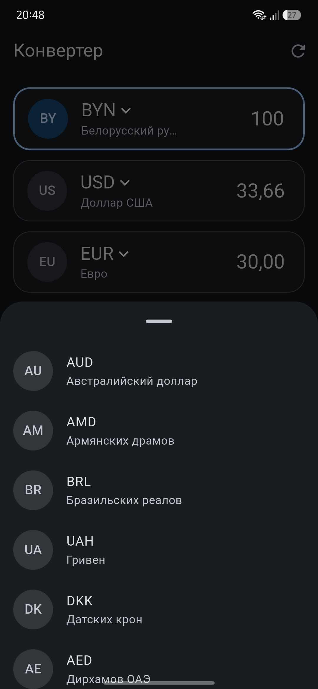

# Currency Converter

A Flutter app that converts between currencies at the official exchange rates of the National Bank of the Republic of Belarus (NBRB).

**Try it:** https://kirimikh.github.io/currency_converter/

| Converter | Currency picker | Light theme | No connection |
|:---:|:---:|:---:|:---:|
|  |  |  |  |

## Features

- Today's official NBRB rates, with BYN as the base currency
- Type an amount in any row and every other row is recalculated from it
- Add currencies from a list with full names, remove a row with a swipe
- Light and dark theme, following the system
- A clear message and a retry button when the rates can't be loaded
- Android app and a web version on GitHub Pages

## Under the hood

- **Money is `Decimal`, never `double`.** A `double` can't hold 2.995 exactly, so `(17 * 2.995).toStringAsFixed(2)` returns `50.91`, while 17 USD at 2.9950 BYN is exactly 50.915 BYN and must round to 50.92. Rates and amounts are `Decimal`, and the result is rounded to kopecks once, at the very end.
- **Every row is converted from the amount the user typed**, not from another row's rounded value, so rounding errors don't add up.
- **Three layers:**
  - `lib/domain`: the `Currency` model and the conversion, pure Dart without Flutter;
  - `lib/data`: `NbrbRepository`, the request with a timeout, JSON parsing and errors;
  - `lib/ui`: the screen state on `ChangeNotifier` and the widgets.
- **One error type.** No network, a timeout, a bad HTTP status or unexpected JSON all become a `RatesException` with a message for the user.

## Tests and CI

- Conversion: cross rates, currencies quoted per 100 units, rounding, and a case where rounding twice would be off by a cent.
- Repository: parsing a real NBRB response and every error case, with `MockClient` instead of the network.

On every push to `main`, GitHub Actions runs `flutter analyze` and `flutter test`, builds the web version and publishes it to GitHub Pages.

## Run locally

Requires Flutter 3.41 or newer.

```bash
flutter pub get
flutter test
flutter run
```

Rates come from the public NBRB API: `https://api.nbrb.by/exrates/rates?periodicity=0`
